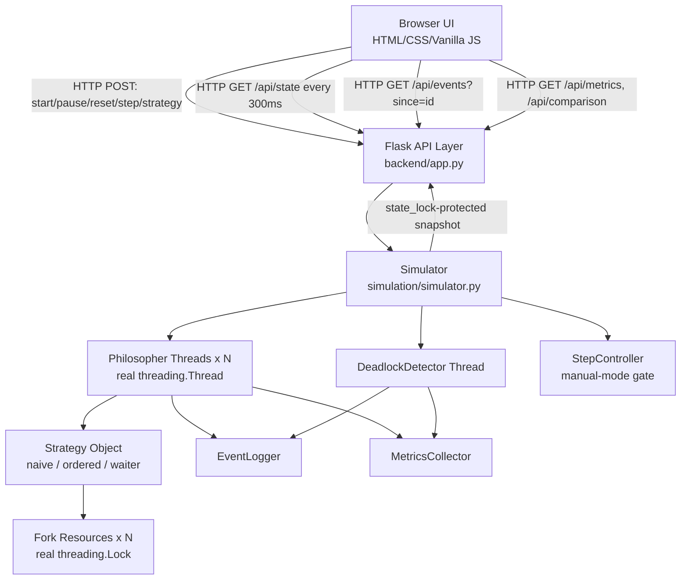
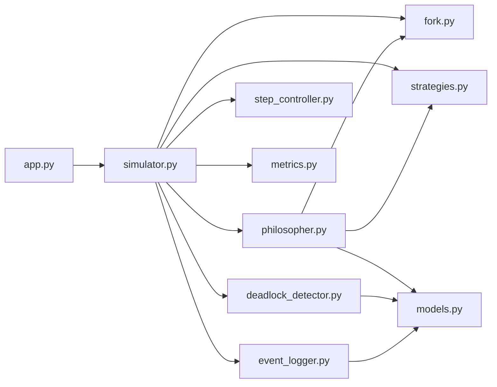
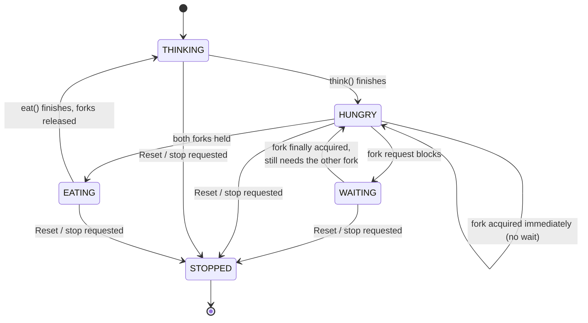
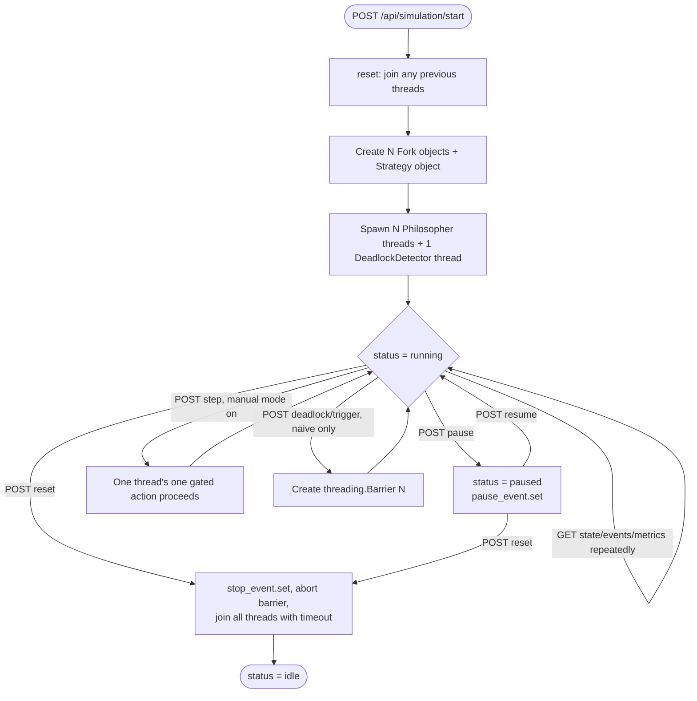
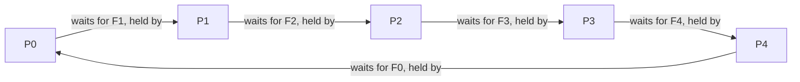
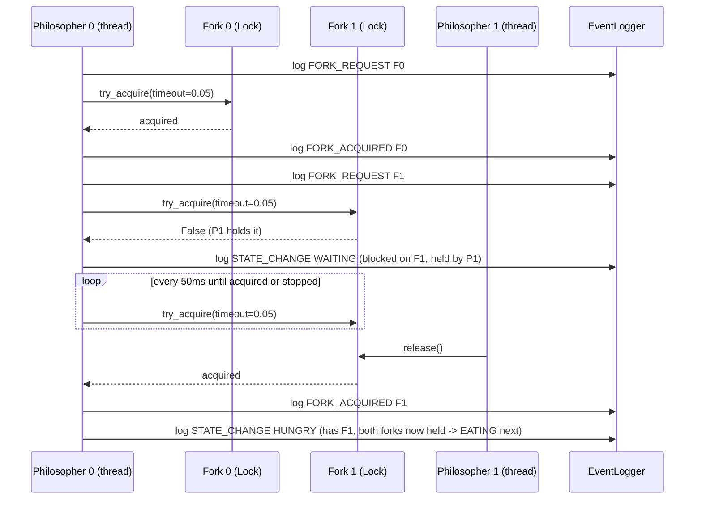
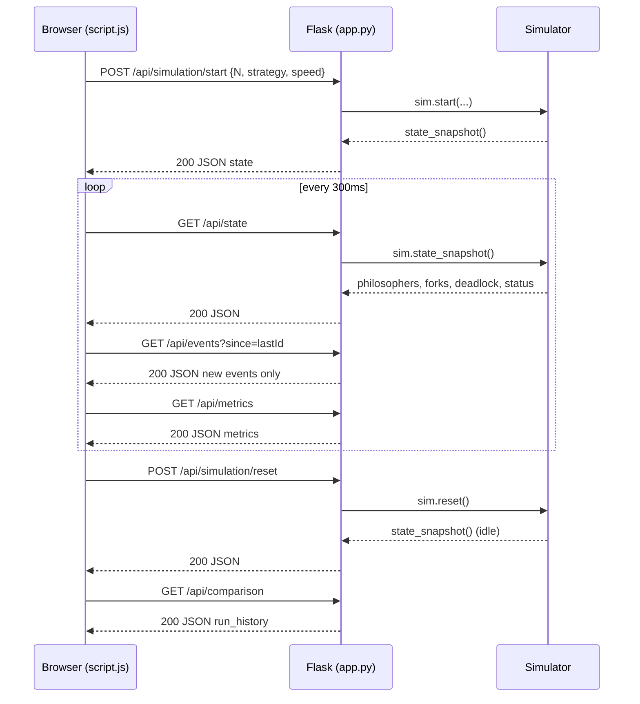

# Architecture

## 1. System Architecture

The browser never talks to threads, locks, or the strategy objects
directly — it only ever calls the Flask layer, which only ever calls the
`Simulator`. This one-way funnel is what keeps the concurrency correctness
independent of anything happening in the browser.

## 2. Module Diagram

`models.py` (enums + the `Event` dataclass) has no dependencies of its own
and is imported by nearly everything else — it is the shared vocabulary
of the whole engine.

## 3. Philosopher State Transition Diagram

Note the `WAITING -> HUNGRY` edge: once a blocked fork is finally
acquired, the philosopher's state returns to `HUNGRY` (it still needs the
second fork) rather than staying labelled `WAITING` with nothing left to
wait for. Both the state and its companion `waiting_for_fork` field are
updated together, under a single lock acquisition, specifically to avoid
a display race where a snapshot could catch `WAITING` paired with a stale
or `None` fork id.

## 4. Simulation Lifecycle Flowchart

## 5. Deadlock Dependency Graph (naive strategy, triggered demo)

This is exactly the graph the `DeadlockDetector` builds from live state
(`Pi -> Pj` whenever `Pi` is `WAITING` for a fork `Pj` currently holds) and
walks to find the cycle — not a static illustration.

## 6. Sequence Diagram: Fork Acquisition (naive strategy, contested case)

## 7. Data Flow Between Frontend and Backend

The frontend never receives raw thread objects or locks, obviously — only
plain JSON built by `state_snapshot()`, `events.get_since()`, and
`metrics.snapshot()`, all of which are read under `state_lock` (or their
own internal lock) so the JSON returned is a consistent point-in-time
view even though five-plus threads are mutating the underlying state
concurrently.

## 8. Concurrency Notes for the Viva

- **CPython's GIL** means only one thread executes Python bytecode at an
  instant, but `Lock.acquire()`, `Semaphore.acquire()`, and
  `time.sleep()` all release the GIL while blocked, so real OS-level
  thread scheduling and real blocking still occur. The problem being
  demonstrated (resource contention and scheduling) is about
  synchronization, not CPU parallelism, so this is not a limitation for
  this project's purpose.
- **Why polling-with-timeout instead of a plain blocking `acquire()`:**
  `Fork.try_acquire(philosopher_id, timeout=0.05)` lets a philosopher
  thread periodically re-check for pause/stop signals while it waits.
  Critically, the philosopher does **not** release a fork it already
  holds while polling for the next one — hold-and-wait is completely
  real, and in the naive strategy's uncontrolled case the retry loop runs
  forever until Reset, a genuine permanent deadlock, not a simulated one.
- **Thread safety split:** `Fork.lock` provides the actual mutual
  exclusion over the resource. `Simulator.state_lock` (a separate `RLock`)
  protects the *metadata* used for display snapshots (`philosopher.state`,
  `.waiting_for_fork`, `.held_forks`) so that a snapshot read from the
  Flask request thread is never torn mid-update.
